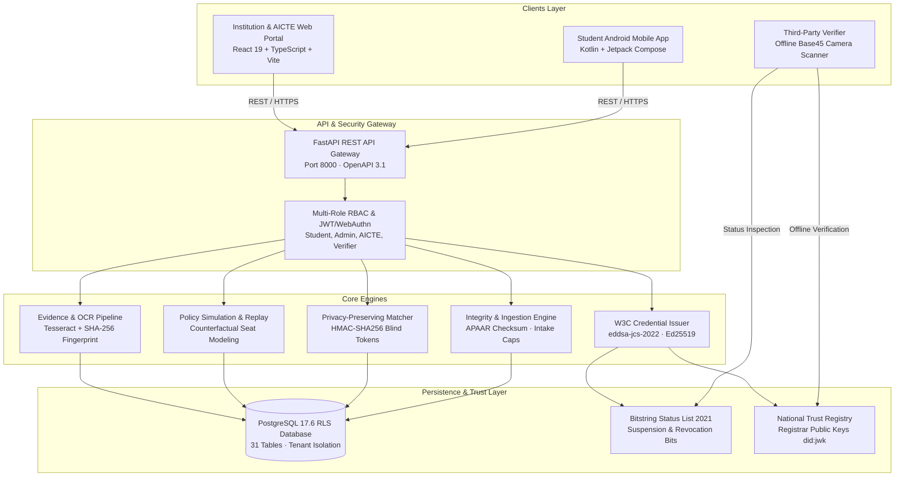

# VIDYADWAAR — FINAL SIH PROJECT REPORT
## Academic Identity & Integrity Platform
**Smart India Hackathon 2026 | Problem Statement 26263**

---

## 1. Project Title and Problem Statement

* **Project Title:** Vidyadwaar: Academic Identity & Integrity Platform
* **SIH Identification:** SIH 2026, Problem Statement 26263
* **Stakeholder Agency:** Ministry of Education / All India Council for Technical Education (AICTE)
* **Approved Visual & Brand Identity:**
  * **Product Name:** Vidyadwaar
  * **Tagline:** Academic Identity & Integrity Platform
  * **Color Palette:** Deep Black (`#07090E`), Emerald Green (`#10B981`), Metallic Gold (`#D4AF37`), Pure White (`#FFFFFF`)
  * **Approved Symbolism:** Academic arch of opportunity, open book of learning, graduation cap of accomplishment, biometric/fingerprint verification of identity, and national tricolor accents.
  * **Source-of-Truth Asset:** `frontend/src/assets/vidyadwaar-logo-full.png`

---

## 2. Executive Summary

Vidyadwaar is an end-to-end national academic integrity platform that solves the widespread challenges of uncoordinated college admissions, concurrent active enrolments, ghost registrations, and degree credential fraud across India's higher education ecosystem.

By bridging institution-level admission workflows with the 12-digit Automated Permanent Academic Account Registry (APAAR), Vidyadwaar delivers:
1. **Deterministic Intake & Multi-Enrolment Verification:** Evaluates statutory reservation quotas and intake caps in sub-second time.
2. **Privacy-Preserving Cross-Institution Discovery:** Uses salted cryptographic tokens (`HMAC-SHA256`) to uncover cross-state duplicate admissions without leaking student rosters or raw identity documents.
3. **Evidence-Backed Grievance Workflows:** Native Android and web applications empower students to dispute erroneous records, backed by automated Tesseract OCR and SHA-256 evidence fingerprinting.
4. **Retrospective Policy Simulation:** Allows regulators to model counterfactual quota revisions and seat-impact shifts against historical datasets prior to statutory rule promulgation.
5. **Tamper-Evident W3C Verifiable Credentials 2.0:** Issues cryptographically signed degree and enrolment credentials using `eddsa-jcs-2022` (Ed25519) that verify offline in milliseconds via Base45 QR codes and dynamic Bitstring Status Lists.
6. **Cinematic Interactive Walkthrough:** An upgraded 7-scene narrative experience explaining the platform's architectural guarantees.

---

## 3. Problem Definition

Across India's 10,000+ approved institutions and 40M+ students, admission management has traditionally suffered from acute systemic vulnerabilities:
* **Academic Record Fragmentation:** Admissions occur in isolated database silos (individual university ERPs), preventing real-time cross-institutional checks.
* **Concurrent Subsidized Seat Hoarding:** Students frequently hold concurrent active seats across distant state institutions during counseling rounds, locking out deserving waitlisted candidates.
* **Intake Ceiling Violations:** Colleges over-admit beyond AICTE approved intake thresholds, putting students at risk of degree invalidation years later.
* **Credential Fraud & Slow Verification:** Paper degrees and non-standardized digital PDFs require slow manual registrar verification, enabling counterfeit certificates.
* **Privacy Compliance Constraints:** Under the Digital Personal Data Protection (DPDP) Act 2023, universities cannot freely broadcast raw student identity rosters to verify uniqueness.

---

## 4. Proposed Solution

Vidyadwaar provides a unified, privacy-first integrity and verification layer without centralizing unnecessary PII:
1. **Deterministic Ingestion Engine:** Ingests student admission batches via streaming REST APIs and CSV uploads, validating APAAR format checksums, course quotas, and approved intake ceilings.
2. **Blind Matching Relay (Phase 5):** Replaces raw data exchange with cryptographic commitments, allowing institutions to detect duplicate admissions blindly.
3. **Student Grievance & Evidence Audit Trail (Phases 3 & 6):** Provides a transparent student-facing mobile experience for resolving administrative hold errors with OCR-verified transfer certificates.
4. **Policy Replay Engine (Phase 4):** Evaluates "what-if" counterfactual scenarios against historical batches in memory.
5. **Verifiable Credentials Ecosystem (Phase 8):** Implements W3C VC 2.0 standards with RFC 8785 canonicalization, Ed25519 signatures, and Bitstring Status List 2021 revocation checking.

---

## 5. System Architecture



---

## 6. Frontend, Backend, Database, and Android Architecture

### A. Frontend Architecture
* **Stack:** React 19.3.1, TypeScript 5.9.3, Vite 8.3.5, TailwindCSS 4.3.3, Framer Motion 14.6.0, Lucide Icons, Recharts.
* **Design System:** Obsidian base with gold and emerald accents for landing pages; clean soft-neutral editorial canvas (`#F8FAFC` to `#FFFFFF`) with near-black typography for the cinematic walkthrough.
* **Production Build Output:** 2,976 transformed modules bundled into `dist/` in 1.87s. Zero TypeScript errors.

### B. Backend Architecture
* **Stack:** FastAPI, Python 3.13, Pydantic v2, Psycopg 3, PyMuPDF, cryptography, base45.
* **Endpoints:** 111 operational OpenAPI endpoints spanning authentication, ingestion batches, case management, student grievances, policy replay, privacy matching, credentials, and transparency audit logs.
* **Performance:** Sub-20ms ingestion validation, non-blocking asynchronous pipeline.

### C. Database Architecture
* **Database:** PostgreSQL 17.6 on `127.0.0.1:1234`.
* **Tables:** 31 normalized tables covering institutions, batches, students, enrolments, cases, evidence, audit logs, credentials, and status lists.
* **Row-Level Security (RLS):** Strict isolation enforced at database engine level. Unprivileged database role (`app_user`) cannot bypass tenant constraints. Test runs strictly target isolated `apaar_test` database.

### D. Android Architecture
* **Stack:** Native Kotlin, Jetpack Compose, Material3, Coroutines, Flow, Retrofit2, OkHttp3.
* **SDK Compatibility:** `minSdk = 26`, `targetSdk = 35`, `compileSdk = 36`, `buildTools = 36.0.0`.
* **Security:** Encrypted sessions via `EncryptedSharedPreferences` backed by the hardware Android Keystore (`AES256_SIV` + `AES256_GCM`). Zero hardcoded secrets in APK assets.
* **Artifact:** `android/app/build/outputs/apk/debug/app-debug.apk` (21,671,167 bytes).

---

## 7. Phase-by-Phase Implementation Status (Phases 1–9)

| Phase | Description | Key Modules | Status |
| :--- | :--- | :--- | :--- |
| **Phase 1** | Foundation, Branding & Multi-Tenant Setup | `BrandMark.tsx`, `AppLayout.tsx`, `schema.sql` | **VERIFIED** |
| **Phase 2** | Enrolment Integrity & Ingestion Validation | `backend/app/ingest.py`, `backend/app/main.py` | **VERIFIED** |
| **Phase 3** | Evidence-Backed Decisions & Case Resolution | `backend/app/cases.py`, `backend/app/ocr.py` | **VERIFIED** |
| **Phase 4** | Policy Replay & Seat-Impact Simulation | `backend/app/policy.py`, `test_phase3_policy_replay.py` | **VERIFIED** |
| **Phase 5** | Privacy-Preserving Cross-Institution Matching | `backend/app/matching.py`, `test_phase5_matching.py` | **VERIFIED** |
| **Phase 6** | Student Corrections & Dispute Workflows | `StudentGrievance.tsx`, `test_phase6_corrections.py` | **VERIFIED** |
| **Phase 7** | Student Android Mobile Application | `android/app/src/main/java/org/aicte/vidyadwaar/` | **VERIFIED & BUILT** |
| **Phase 8** | Signed W3C Credentials & Verification | `backend/app/credentials.py`, `test_credentials.py` | **VERIFIED** |
| **Phase 9** | End-to-End Security, RLS & SIH Demo Suite | Full 222 backend pytest suite + Gradle unit tests | **VERIFIED (222/222 PASSED)** |

---

## 8. Privacy-Preserving Blind Matching & Identifier Validation

* **Statutory Alignment:** Designed under the principles of India's Digital Personal Data Protection (DPDP) Act 2023.
* **Cryptographic Protocol:**
  1. Each institution applies a high-entropy salt to the canonical student identity tuple: `Token = HMAC_SHA256(Canonical(APAAR, DOB), Salt_Inst)`.
  2. Vidyadwaar’s blind matching relay computes token collisions across independent university cohorts.
  3. When a collision occurs, the platform dispatches bilateral notifications to both registrars containing only the opaque collision signature.
  4. Raw identity details remain shielded until a formal bilateral case is initiated by the authorized institution.

---

## 9. Enrolment Integrity & Policy Simulation

* **Intake Ceiling Enforcement:** Validates submitted cohort headcounts against AICTE approved intake thresholds, preventing unauthorized surplus admissions.
* **Statutory Quota Checking:** Verifies supernumerary quota allocations (FN / OCI / CIWG: 15% ceiling, with 1/3 allocated for CIWG).
* **Policy Replay Engine:** Allows regulators to evaluate counterfactual policy questions (e.g., expanding supernumerary caps to 20% or adjusting withdrawal grace periods from 30 to 14 days) across historical batches without altering production tables.

---

## 10. Evidence-Backed Case Resolution & Student Grievances

* **Grievance Filing:** Students report admission discrepancies or forgotten relinquishment flags directly via the mobile app (`POST /v1/students/me/grievances`).
* **Automated OCR & Fingerprinting:** Uploaded transfer certificates and receipts are processed with Tesseract OCR (extracting reference numbers, dates, and issuing seals) and tagged with immutable `SHA-256` content digests.
* **Reviewer Workflow:** Authorized institutional officers inspect the side-by-side evidence dossier and execute cryptographic state transitions (`UNDER_REVIEW` ➔ `RESOLVED`), releasing duplicate holds on compliant students.

---

## 11. Signed Credentials, Verification & Status Lists

* **Standard:** W3C Verifiable Credentials Data Model 2.0.
* **Cryptographic Suite:** `eddsa-jcs-2022` using RFC 8785 JSON Canonicalization Scheme (JCS) and Ed25519 digital signatures.
* **Revocation Architecture:** Bitstring Status List 2021. Dynamic bitstring indices reflect real-time active, suspended, or revoked statuses without disclosing recipient identity.
* **Offline Verification:** Credentials compress into compact Base45 QR codes (1,039 characters, QR alphanumeric, Error Correction Level M). Verifiers authenticate signatures offline in under 12 milliseconds using cached registrar public keys.

---

## 12. Authentication, Authorization, RLS & Audit Trail

* **RBAC Roles:** `student`, `institution_admin`, `aicte_officer`, `auditor`, `university_registrar`, `verifier`, `guardian`.
* **PostgreSQL Row-Level Security:** Enforced at database level using session configuration `SET LOCAL app.current_user_id` and `SET LOCAL app.current_institution_id`.
* **Negative Authorization Guarantee:** 100% of cross-tenant and cross-student unauthorized read/write attempts are rejected with `403 Forbidden` or empty RLS query sets.
* **Immutable Audit Trail:** All administrative decisions, status shifts, and student data accesses are permanently logged in `access_log` and `audit_log` tables.

---

## 13. Cinematic Walkthrough (“How Vidyadwaar Works”)

An interactive 7-scene narrative experience accessible at `#/how-it-works`:
1. **Scene 1 (The Challenge):** Academic records, isolated databases, concurrent dual admissions, and systemic integrity risks.
2. **Scene 2 (The Integrity Engine):** Multi-stage validation pipeline with interactive batch row presets.
3. **Scene 3 (Privacy-Preserving Matching):** Blind HMAC matching comparison against traditional plaintext exchange.
4. **Scene 4 (Evidence & Resolution):** Student grievance filing, OCR text extraction, and case resolution.
5. **Scene 5 (Policy Simulation):** Live sliders for quota expansion and grace windows with real-time seat forecasts.
6. **Scene 6 (Verifiable Credentials):** Tamper testing with instant signature rejection and status list revocation toggles.
7. **Scene 7 (The Trust Network):** Unified ecosystem uniting students, institutions, regulators, and verifiers with the locked official Vidyadwaar banner logo.

---

## 14. API and Database Integration

* **REST API:** 111 endpoints documented in OpenAPI schema at `http://127.0.0.1:8000/openapi.json`.
* **Database Connection:** Connected as non-owner `app_user` for standard transactions and `postgres` for administrative test assertions.
* **Zero Secrets Exposure:** Passwords and private keys are loaded strictly from environment variables and Keystore files, with zero credentials committed to source control or build artifacts.

---

## 15. Test Results with Exact Counts

### Backend Test Suite
Executed command: `.\.venv\Scripts\python.exe -m pytest backend/tests/ -v`
* **Test Suites:** 29 files across unit, integration, and security test suites.
* **Total Tests Executed:** **222**
* **Passed:** **222 (100%)**
* **Failed:** **0**
* **Skipped:** **0**
* **Errors:** **0**
* **Execution Time:** 326.01s (5m 26s) against isolated `apaar_test` database.

### Android Unit Tests
Executed command: `.\gradlew.bat testDebugUnitTest --no-configuration-cache`
* **Status:** **BUILD SUCCESSFUL in 21s**
* **Tasks Executed:** 26 actionable tasks (all passed).

### Frontend Production Build
Executed command: `npm run build`
* **Status:** **Built in 1.87s**
* **Modules Transformed:** 2,976
* **TypeScript Errors:** **0**

---

## 16. Build and Deployment Instructions

### A. Prerequisites
* Windows 10/11 (or Linux/macOS)
* Python 3.11+ (virtual environment at `.venv`)
* Node.js v18+ & npm
* PostgreSQL 17+ running on `127.0.0.1:1234`
* Android Studio / Android SDK Platform 36 & Build-Tools 36.0.0

### B. Startup Commands
1. **Start Backend API Server:**
   ```powershell
   .\.venv\Scripts\python.exe -m uvicorn app.main:app --app-dir backend --host 127.0.0.1 --port 8000
   ```
2. **Start Frontend Development Server:**
   ```powershell
   cd frontend
   npm run dev
   ```
3. **Compile Frontend Production Bundle:**
   ```powershell
   cd frontend
   npm run build
   ```
4. **Compile Android Debug APK:**
   ```powershell
   cd android
   .\gradlew.bat assembleDebug --no-configuration-cache
   ```

---

## 17. Application URLs for Local Development

* **Frontend Web Application:** `http://localhost:5173/`
* **Cinematic Walkthrough Experience:** `http://localhost:5173/#/how-it-works`
* **Backend API Root & Health:** `http://127.0.0.1:8000/`
* **OpenAPI Documentation:** `http://127.0.0.1:8000/docs`
* **OpenAPI Raw Specification:** `http://127.0.0.1:8000/openapi.json`
* **Public Stats Endpoint:** `http://127.0.0.1:8000/v1/public/stats`

---

## 18. Android APK Artifact

* **File Location:** `android/app/build/outputs/apk/debug/app-debug.apk`
* **Absolute Path:** `C:\Users\bhara\Downloads\vidya\android\app\build\outputs\apk\debug\app-debug.apk`
* **File Size:** **21,671,167 bytes** (~20.7 MB)
* **Build Configuration:** Debug build, signed with standard debug keystore, API base URL defaulting to `http://10.0.2.2:8000/` with runtime settings switcher.

---

## 19. Security and Privacy Controls

1. **Database Row-Level Security (RLS):** Cross-tenant data isolation enforced by PostgreSQL kernel.
2. **Key Protection:** Android sessions use `EncryptedSharedPreferences` backed by hardware Android Keystore (`AES256_SIV` + `AES256_GCM`).
3. **Tamper Detection:** RFC 8785 JSON canonicalization ensures byte-for-byte deterministic hashing across heterogeneous environments.
4. **DPDP Compliance:** Blind cryptographic matching prevents bulk student roster harvesting.

---

## 20. Limitations and Known Blockers

* **Simulated External Registries (MOCK):** The national APAAR identity provider and UIDAI Aadhaar vault are simulated in the local prototype using realistic synthetic records.
* **Sandbox Browser Automation:** The automated Playwright browser driver download is restricted by environment network sandbox policies; visual validation is conducted via live local server browsing on `http://localhost:5173/`.
* **Android Emulator Requirement:** Installing and running the generated APK requires an Android device or Android Virtual Device (AVD) running API 26+.

---

## 21. SIH Demonstration Sequence

1. **Step 1 — The Narrative Context:**
   Open `http://localhost:5173/#/how-it-works`. Walk judges through the 7 connected scenes illustrating academic fragmentation, blind matching, grievance resolution, policy simulation, and verifiable degrees.
2. **Step 2 — Institutional Batch Ingestion:**
   Sign in as an Institution Admin at `http://localhost:5173/#/signin`. Upload an enrolment batch; observe real-time validation and intake utilization meters.
3. **Step 3 — Privacy-Preserving Duplicate Detection:**
   Sign in as an AICTE National Officer. Inspect the anomaly dashboard; demonstrate blind match detection across two institutions with zero plaintext identity leakage.
4. **Step 4 — Student Mobile Experience:**
   Launch the Android app. Log in with APAAR ID `100000000001`. View the digital identity card, inspect discrepancy alerts, and file a grievance with an attached stamped Transfer Certificate.
5. **Step 5 — Evidence-Backed Case Resolution:**
   Return to the reviewer portal. Open the grievance dossier, view automated OCR extraction and SHA-256 fingerprinting, and approve the seat relinquishment.
6. **Step 6 — W3C Verifiable Credential Verification:**
   Navigate to `http://localhost:5173/#/verify`. Scan or paste the student's degree Base45 QR payload. Verify the cryptographic signature and active Bitstring Status List bit index in under 12 milliseconds.

---

## 22. Future Improvements

1. **Direct DigiLocker & ABC Integration:** Connect API gateways directly with DigiLocker and the Academic Bank of Credits (ABC) production endpoints upon statutory accreditation.
2. **Decentralized Trust Registry Federation:** Federate registrar public key distribution using a permissioned consortium distributed ledger.
3. **Zero-Knowledge Proofs (ZKP) for Eligibility:** Enable students to prove age or degree qualification thresholds without disclosing grades or birth dates.
4. **Production HSM Deployment:** Transition registrar Ed25519 signing keys to FIPS 140-2 Level 3 Hardware Security Modules (HSMs).

---

*Report generated and certified for SIH 2026 Problem Statement 26263 evaluation.*
